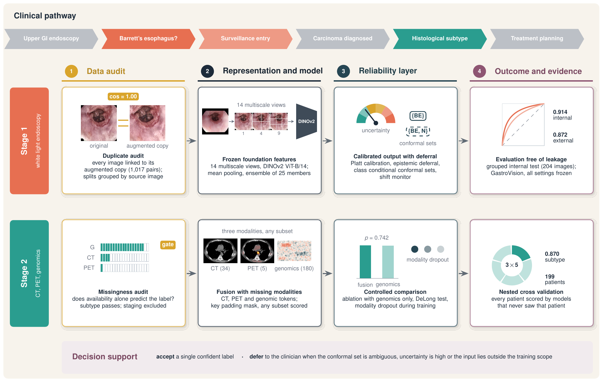

# Calibrated deep learning with conformal deferral for esophageal cancer

Code, results and figures for the paper

> A. P. Mohod and K. P. Yadav, "Calibrated Deep Learning with Conformal Deferral for Barrett's
> Esophagus Recognition and Multimodal Characterization of Esophageal Cancer."

The study has two stages that follow the clinical pathway.

* **Stage 1** separates Barrett's esophagus (BE) from the normal Z line on white light
  endoscopy. Fourteen multiscale views of each image are encoded by a frozen DINOv2 ViT-B/14,
  mean pooled, and scored by a cross fitted ensemble of 25 members with Platt calibration,
  uncertainty decomposition, selective deferral and class conditional conformal prediction.
* **Stage 2** classifies squamous cell carcinoma versus adenocarcinoma from CT, PET and genomic
  embeddings with a masked self attention network that accepts any subset of modalities.

Two data audits come before any result is reported. The **duplicate audit** links every
augmented image to its source image so that no image and its copy can fall on both sides of a
split. The **missingness audit** checks whether the availability of a modality alone predicts a
label. In this study it showed that an apparent staging AUROC of 0.979 came from the pattern of
missing data, so staging was excluded as an endpoint.



## Main results

| Analysis | Result |
|---|---|
| Internal test, 204 source images (19 BE) | AUROC 0.914 (95% CI 0.854 to 0.967), ECE 0.044, calibration slope 1.00 |
| Error detection by epistemic uncertainty | AUROC 0.898; referring 20% of images lowers the error rate from 7.4% to 1.8% |
| Conformal sets at alpha = 0.10 | single label for 73.0% of images, correct in 90.6% of them |
| External, GastroVision BE vs normal Z line (frozen settings) | AUROC 0.872 (0.830 to 0.909), ECE 0.060 |
| Stage 2 subtype, nested CV, 199 patients | AUROC 0.870 (0.819 to 0.917); genomics only 0.867 (DeLong p = 0.742) |
| Missingness audit | subtype passes (availability only AUROC 0.561); staging fails and is excluded |

## Repository layout

```
src/esca_sci_pipeline.py          complete analysis (Stage 1, external validation, Stage 2)
notebooks/ESCA_SCI_Kaggle.ipynb   the Kaggle notebook that produced every reported value
scripts/
  reproduce_paper_statistics.py   recomputes 27 statistics of the paper from saved predictions
  missingness_audit.py            the Stage 2 missingness audit (Table IX)
  make_result_figures.py          Figs. 4, 5 and 7 from the saved predictions
  make_diagram_assets.py          image panels used inside the architecture diagrams
results/
  stage1_results.json, external_results.json, stage2_results.json
  tables/                         every table written by the pipeline (CSV)
  stage2/                         Stage 2 nested cross validation results
  predictions/                    internal, out of fold and external predictions; trained ensemble
  figures_pipeline/               figures written directly by the pipeline (S2_stage_roc_pr.png
                                  shows the auxiliary stage head, which is not a reported endpoint)
figures/
  diagrams/                       Figs. 1 to 3 (PDF and 300 dpi PNG)
  results/                        Figs. 4, 5 and 7 (PDF and PNG)
  tikz/                           LaTeX sources of Figs. 1 to 3
  assets/                         image panels used by the diagrams
paper/                            LaTeX source, figures and PDF of the manuscript
docs/                             data access, reproduction steps, reporting checklist
```

## Quick check (no GPU, a few seconds)

```bash
pip install -r requirements.txt
python scripts/reproduce_paper_statistics.py
```

The script reads the saved predictions, recomputes the calibration slope, Brier skill score,
workload figures, deferral results and external metrics, and compares each value with the
paper. All 27 values match.

To redraw the result figures:

```bash
python scripts/make_result_figures.py
```

## Full reproduction on Kaggle

1. Create a Kaggle notebook and import `notebooks/ESCA_SCI_Kaggle.ipynb`.
2. Settings: GPU accelerator (T4 or P100), internet on (DINOv2 is downloaded once from torch.hub
   to encode the GastroVision images).
3. Attach the datasets `bhavanamohod/final-mm-features` and
   `orvile/gastrovision-gastrointestinal-disease-detection`.
4. Keep `QUICK = False` in cell 3 and run all cells. Stage 1 takes about 12 minutes.
5. Download `/kaggle/working/esca_sci_outputs.zip`. Its JSON and CSV files are the ones stored in
   `results/`.

The steps, expected outputs and the run of the missingness audit are described in
[docs/REPRODUCE.md](docs/REPRODUCE.md). Data sources are listed in [docs/DATA.md](docs/DATA.md).

## Requirements

Python 3.10 or later. The packages are listed in `requirements.txt`. The full pipeline needs a
CUDA GPU; the scripts in `scripts/` run on a CPU.

## Citation

If you use this code, please cite the paper. A `CITATION.cff` file is included, so GitHub shows
a citation entry on the repository page.

## License

The code is released under the MIT License (see `LICENSE`). The datasets keep their own licenses
and terms of use. The chest CT slice shown in Fig. 3 comes from the public sample data of
3D Slicer. The endoscopy frame shown in Figs. 1 and 2 is a single deidentified sample image;
all burned in text was removed before use.

## Contact

Ashish P. Mohod, Department of Computer Science and Engineering, MATS University, Raipur, India
(mohod.ashish@gmail.com).
